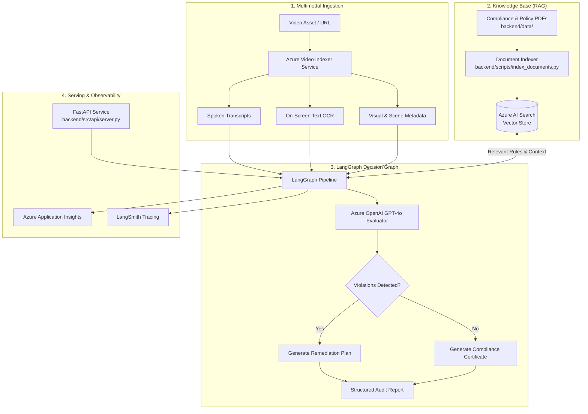

# Multimodal Compliance QA Pipeline — Brand Guardian

> **Automated, agentic video compliance auditing powered by Azure Video Indexer, Azure AI Search, Azure OpenAI, and LangGraph.**

[](https://www.python.org/)
[](https://langchain-ai.github.io/langgraph/)
[](https://fastapi.tiangolo.com/)
[](https://azure.microsoft.com/)
[](LICENSE)

---

## Overview

Modern marketing workflows demand strict adherence to platform policies, technical specifications, and legal regulations — such as FTC influencer endorsement guidelines, claim substantiation requirements, brand safety standards, and platform-specific format constraints (e.g., YouTube Ad specs). Manually reviewing high-volume multimedia assets across these diverse rule sets is slow, error-prone, and impossible to scale.

**Brand Guardian** provides an end-to-end automated auditing framework by orchestrating:

| Component | Role |
|-----------|------|
| **Azure Video Indexer** | Extracts transcript, OCR text, visual tags, and scene metadata from video |
| **Azure AI Search** | Stores and retrieves compliance rule chunks via vector similarity |
| **Azure OpenAI (GPT-4o)** | Evaluates extracted signals against policy context; writes structured reports |
| **LangGraph** | Orchestrates the multi-step pipeline as a stateful decision graph |
| **FastAPI** | Asynchronous REST API with job submission and polling |
| **Azure Application Insights** | End-to-end observability via OpenTelemetry |
| **LangSmith** | LLM execution tracing and debugging |

---

## Architecture



---

## Project Structure

```text
multimodel/
├── .gitignore
├── README.md                              ← You are here
└── complianceQApipeline/
    ├── .env.example                       ← Copy to .env and fill credentials
    ├── main.py                            ← CLI entry point
    ├── pyproject.toml                     ← Dependencies (managed by uv)
    ├── README.md                          ← Pipeline-level docs
    └── backend/
        ├── data/                          ← Compliance PDF documents
        │   ├── 1001a-influencer-guide-508_1.pdf
        │   └── YouTube_Ad_Specs_Guide_2026.pdf
        ├── scripts/
        │   └── index_documents.py         ← Ingest PDFs → Azure AI Search
        └── src/
            ├── api/
            │   ├── server.py              ← FastAPI app + job endpoints
            │   └── telemetry.py           ← Azure Monitor / OpenTelemetry setup
            ├── graph/
            │   ├── __init__.py
            │   ├── nodes.py               ← index_video | retrieve | audit | report
            │   ├── state.py               ← VideoAudioState TypedDict
            │   └── workflow.py            ← LangGraph StateGraph compilation
            └── services/
                ├── __init__.py
                └── video_indexer.py       ← Azure Video Indexer client
```

---

## Getting Started

### 1. Prerequisites

- Python 3.11+
- [`uv`](https://docs.astral.sh/uv/) (recommended) or `pip`
- Azure subscription with the following services provisioned:
  - Azure OpenAI (GPT-4o + text-embedding-3-small deployments)
  - Azure AI Search
  - Azure Video Indexer (ARM-based)
  - Azure Blob Storage
  - Azure Application Insights *(optional — for observability)*

### 2. Clone & Install

```bash
git clone https://github.com/om520/Multimodal-Compliance-QA-Pipeline.git
cd Multimodal-Compliance-QA-Pipeline/complianceQApipeline

# Using uv (recommended)
uv sync

# Or standard pip
pip install -e .
```

### 3. Configure Environment

```bash
cp .env.example .env
# Open .env and fill in all credential values
```

> ⚠️ **Never commit your `.env` file** — it is listed in `.gitignore`.

### 4. Index Compliance Documents

Parse the PDFs in `backend/data/` and push embeddings to Azure AI Search:

```bash
python backend/scripts/index_documents.py
```

### 5a. Run the FastAPI Server

```bash
uvicorn backend.src.api.server:app --host 0.0.0.0 --port 8000 --reload
```

Interactive docs: [http://localhost:8000/docs](http://localhost:8000/docs)

**Submit an audit job:**
```bash
curl -X POST http://localhost:8000/audit \
  -H "Content-Type: application/json" \
  -d '{"video_url": "https://www.youtube.com/watch?v=EXAMPLE"}'
```

**Poll for results:**
```bash
curl http://localhost:8000/audit/{job_id}
```

### 5b. Run via CLI

```bash
python main.py --video-url "https://www.youtube.com/watch?v=EXAMPLE" --video-id my_audit_01
```

---

## Compliance Checks

| Dimension | What Gets Checked |
|-----------|------------------|
| **FTC Disclosure** | Sponsorship disclosures — clear, conspicuous, and timely? |
| **Claim Substantiation** | Unsubstantiated performance or benefit claims |
| **Brand Safety** | Content that could harm brand reputation |
| **Platform Ad Specs** | Duration, aspect ratio, audio levels per platform guidelines |

---

## Audit Score

| Score | Status | Meaning |
|-------|--------|---------|
| 80–100 | ✅ PASS | Asset meets compliance requirements |
| 0–79 | ❌ FAIL | Violations detected — remediation required |

Each issue deducts from the score: **critical** (−20), **warning** (−7), **info** (−2).

---

## Development

```bash
# Run tests (once implemented)
pytest backend/tests/

# Type checking
mypy complianceQApipeline/

# Linting
ruff check .
```

---

## License

This project is licensed under the **MIT License**. See [LICENSE](LICENSE) for details.
