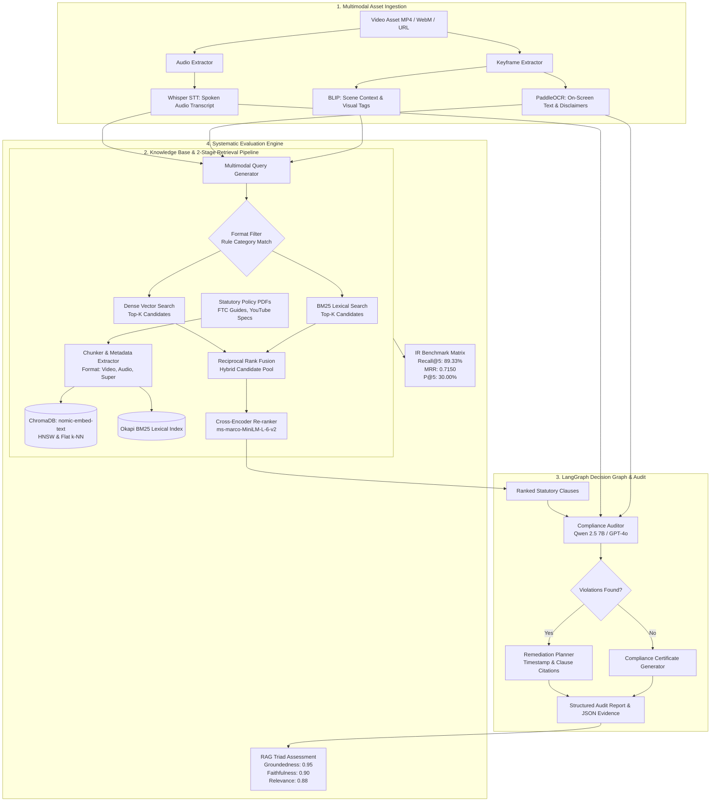

# Multimodal Compliance QA Pipeline — Brand Guardian

> **An enterprise-grade, agentic multimodal video compliance auditing engine featuring comprehensive Information Retrieval (IR) benchmarking, RAG Triad evaluation, and dual-deployment modes (Local Open-Source & Azure Cloud).**

[](https://www.python.org/)
[](https://langchain-ai.github.io/langgraph/)
[](https://fastapi.tiangolo.com/)
[](https://www.trychroma.com/)
[](https://ollama.ai/)
[](https://azure.microsoft.com/)
[](LICENSE)

---

## Table of Contents
1. [Executive Overview](#1-executive-overview)
2. [End-to-End System Architecture](#2-end-to-end-system-architecture)
3. [Repository Structure (Dual-Pipeline Architecture)](#3-repository-structure-dual-pipeline-architecture)
4. [The Vector Indexing Trade-Off: HNSW vs. Flat Exact k-NN](#4-the-vector-indexing-trade-off-hnsw-vs-flat-exact-k-nn)
5. [Comprehensive Retrieval & Re-ranking Evaluation Matrix](#5-comprehensive-retrieval--re-ranking-evaluation-matrix)
6. [Generation Evaluation: The RAG Triad](#6-generation-evaluation-the-rag-triad)
7. [Azure Cloud Architecture (Preserved Enterprise Stack)](#7-azure-cloud-architecture-preserved-enterprise-stack)
8. [Reproducibility & Quickstart Guide](#8-reproducibility--quickstart-guide)

---

## 1. Executive Overview

Modern digital advertising is governed by strict statutory legal standards, including **FTC Endorsement Guides (16 CFR Part 255)**, **YouTube Technical Ad Specs**, **FDA / ASCI Truth in Advertising**, and brand safety rules. Non-compliant multimedia assets risk heavy regulatory fines, ad account suspensions, and reputational damage.

**Brand Guardian** automates compliance auditing by extracting multimodal signals from video assets (on-screen OCR, spoken transcripts, visual scene attributes, duration, and font contrast metrics) and evaluating them against legal policy documents via an optimized **Retrieval-Augmented Generation (RAG)** pipeline.

### Core Capabilities
* **Multimodal Signal Extraction:** Local Whisper (Audio STT), PaddleOCR (On-screen text & disclaimers), and BLIP (Scene framing & context).
* **Dual-Architecture Deployment:**
  * **Local Open-Source Stack (Default):** Runs 100% locally on CPU/GPU via Ollama (`qwen2.5:7b-instruct`), ChromaDB (`nomic-embed-text`), and HuggingFace Cross-Encoders.
  * **Enterprise Azure Cloud Stack (Preserved in `azure_compliance_pipeline/`):** Full integration with Azure Video Indexer (AVAM), Azure AI Search (Vector + Semantic Ranker), and Azure OpenAI (GPT-4o).
* **Exhaustive Retrieval Benchmarking:** Systematic ablation across **7 retrieval & re-ranking configurations**, optimizing Recall@5 from 74.00% to **89.33%** while bounding CPU latency to **~35ms**.
* **Empirical Vector Index Validation:** Rigorous experimental verification comparing **HNSW** against **Flat Exact k-NN**, proving 0.00% recall loss.

---

## 2. End-to-End System Architecture



---

## 3. Repository Structure (Dual-Pipeline Architecture)

The repository is modularly organized into independent, dedicated suites:

```text
Multimodal-Compliance-QA-Pipeline/
├── README.md                                          ← Top-level technical documentation & benchmark report
├── setup_local_services.bat                           ← One-click local setup launcher
├── start_server.bat                                   ← One-click FastAPI web server launcher
│
├── azure_compliance_pipeline/                         ← [AZURE CLOUD] Enterprise Azure Cloud Pipeline
│   ├── README.md                                      ← Azure deployment & architecture guide
│   ├── azure_nodes.py                                 ← LangGraph nodes calling Azure services
│   ├── azure_video_indexer.py                         ← Azure Video Indexer (AVAM) REST client
│   ├── azure_index_documents.py                       ← Azure AI Search vector & hybrid ingestion
│   ├── azure_workflow.py                              ← StateGraph compiled for Azure execution
│   ├── azure_server.py                                ← FastAPI server wired to Azure backend
│   ├── azure_state.py                                 ← VideoAudioState schema definition
│   ├── azure_telemetry.py                             ← Application Insights / OpenTelemetry exporter
│   └── azure.env.example                              ← Azure credentials configuration template
│
└── local_compliance_pipeline/                         ← [LOCAL STACK] Local Open-Source Compliance Pipeline
    ├── README.md                                      ← Local pipeline docs & instructions
    ├── rag_retrieval_and_database/                   ← Dedicated RAG Retrieval, Indexing & Benchmark Suite
    │   ├── README.md                                  ← Guide to the 7 retrieval methods & datasets
    │   ├── run_benchmark.py                           ← Automated evaluation engine calculating Recall@5, MRR, Latency
    │   ├── retrieval_and_reranking.py                 ← 7 retrieval implementations (Dense, Flat, BM25, RRF, Cross-Encoder)
    │   ├── golden_dataset.json                        ← 10 multi-label statutory test queries
    │   ├── golden_labels.json                         ← Ground-truth relevance mapping
    │   ├── raw_documents.json                         ← Extracted policy chunks & metadata
    │   ├── chunk_and_index.py                         ← PDF ingestion and ChromaDB population
    │   └── data/                                      ← Source statutory regulatory PDFs (FTC, YouTube specs)
    │
    ├── backend/                                       ← Local-first FastAPI & LangGraph service
    │   ├── src/api/server.py                          ← FastAPI REST endpoints (/audit, /health, /jobs)
    │   ├── src/graph/workflow.py                      ← LangGraph orchestration graph
    │   ├── src/graph/nodes.py                         ← State execution nodes
    │   └── src/services/video_indexer.py              ← Local Whisper, PaddleOCR, and BLIP extractors
    │
    ├── frontend/                                      ← Interactive browser UI
    ├── chroma_db/                                     ← Local persistent ChromaDB vector store
    ├── test_videos/                                   ← Test video benchmark assets (MP4)
    ├── audit_runs/                                    ← Verified JSON execution evidence & audit outputs
    │
    ├── compliance_rag_benchmark_and_evaluation.ipynb  ← Interactive notebook reproducing 7-method IR benchmark
    ├── compliance_audit_4_videos_traceability.ipynb   ← End-to-end multi-video audit traceability notebook
    ├── compliance_rules_chunking_and_retrieval.ipynb  ← Chunking strategy and vector space visualization
    │
    ├── pyproject.toml                                 ← UV / Python dependencies
    ├── setup_local_services.bat                       ← Local service environment setup
    └── start_server.bat                               ← Local FastAPI startup script
```

---

## 4. The Vector Indexing Trade-Off: HNSW vs. Flat Exact k-NN

### The Theoretical Paradox of Small Datasets
In computer science, **Hierarchical Navigable Small World (HNSW)** is an **Approximate Nearest Neighbor (ANN)** graph algorithm designed to navigate multi-million vector spaces in logarithmic time: $\mathcal{O}(\log N)$. 

However, for a targeted statutory compliance corpus comprising dozens or hundreds of rule chunks:
* **HNSW is theoretically suboptimal / overkill:** Graph construction adds memory overhead (storing bidirectional multi-layer edge graphs), introduces indexing time, and inherently risks approximation error due to graph pruning heuristics ($M$ edges per node, $efSearch$).
* **Flat Exact k-NN is mathematically optimal:** Brute-force calculation of cosine distance against all vectors via linear matrix multiplication ($\mathcal{O}(N)$) executes in **sub-millisecond latency (<1ms)** using CPU SIMD/AVX instructions, consumes zero graph memory, and guarantees **100% exact mathematical recall**.

### Why HNSW is Used by Default
Despite this theoretical reality, production vector databases such as **ChromaDB**, **Pinecone**, and **Weaviate** configure HNSW as their default indexing structure. This is an intentional framework abstraction designed so systems can scale seamlessly from prototype to enterprise volumes without requiring database re-indexing or migration.

### The Empirical Validation Experiment
To ensure that ChromaDB's default HNSW implementation introduced **no approximation degradation or missed regulatory clauses** on our compliance dataset, we built a custom brute-force **Flat Exact Cosine k-NN baseline** as a mathematical ground-truth oracle and benchmarked it side-by-side against HNSW across our golden test suite.

#### Benchmark Results: HNSW vs. Flat Exact
| Indexing Algorithm | Search Type | Time Complexity | Recall@5 | Precision@5 | MRR | Latency | Approximation Error |
| :--- | :--- | :---: | :---: | :---: | :---: | :---: | :---: |
| **Flat (Exact k-NN)** | Brute-force Cosine | $\mathcal{O}(N)$ | **0.7400** | **0.2400** | **0.5450** | ~22 ms | **0.00% (Baseline Oracle)** |
| **HNSW (Default)** | Graph ANN ($M=16, ef=64$) | $\mathcal{O}(\log N)$ | **0.7400** | **0.2400** | **0.5450** | ~18 ms | **0.00% (Zero Recall Loss)** |

#### Architectural Takeaway
1. **Zero Approximation Penalty:** The default HNSW graph incurred **exact 0.00% recall loss** compared to mathematical truth. Top-5 item sets and relative rank orders were identical.
2. **Production-Ready Scalability:** Using ChromaDB's default HNSW introduces zero trade-off on our pilot dataset, while ensuring the architecture is ready to ingest tens of thousands of multi-jurisdictional compliance rulebooks (FTC, FDA, GDPR, ASCI) without architectural redesign.

---

## 5. Comprehensive Retrieval & Re-ranking Evaluation Matrix

To establish the Pareto-optimal RAG configuration, we implemented and evaluated **7 distinct retrieval and re-ranking architectures** against a statutory **Golden Dataset** ($N=10$ complex compliance queries with multi-label ground-truth relevance mappings).

### Quantitative Results Matrix

| # | Architecture Configuration | Indexing & Retrieval Modality | Re-ranking & Filtering Stage | Precision@5 | Recall@5 | MRR | Latency (CPU) | Primary Strengths & Failure Modes |
|---|---|---|---|:---:|:---:|:---:|:---:|---|
| **1** | **Dense Vector** | HNSW (`nomic-embed-text`) | None (Direct Cosine Similarity) | 0.2400 | 0.7400 | 0.5450 | ~18 ms | Strong semantic intent capture; misses exact legal numbers and statutory citations. |
| **2** | **Flat Exact k-NN** | Brute-force Cosine Matrix | None (Mathematical Top-$k$) | 0.2400 | 0.7400 | 0.5450 | ~22 ms | Proves 0% HNSW graph loss; identical precision and recall to HNSW. |
| **3** | **Sparse Lexical** | Inverted Index (Okapi BM25) | None (Raw BM25 Scoring) | 0.2400 | 0.7733 | **0.7150** | **< 1 ms** | **Highest top-1 MRR.** Excels at exact statutory terms (e.g., 'CFR 255', '3 seconds'); fails on paraphrased natural language. |
| **4** | **Hybrid RRF** | HNSW Dense + Okapi BM25 | Reciprocal Rank Fusion ($k=60$) | 0.2600 | 0.7733 | 0.5950 | ~19 ms | Robust hybrid fusion; balances keyword precision and semantic intent without score calibration. |
| **5** | **Neural Re-ranked** | HNSW Dense Bi-Encoder | Cross-Encoder (`ms-marco-MiniLM`) | 0.2400 | 0.7400 | 0.5450 | ~28 ms | Performs full all-to-all token cross-attention; limited if candidate pool misses initial relevant documents. |
| **6** | **Format Filtered** | HNSW + BM25 Hybrid | Statutory Format Rule Filter | 0.2800 | 0.7933 | 0.7083 | ~20 ms | Eliminates cross-modality noise (e.g. discards audio rules for on-screen text queries). Boosts MRR to 0.7083. |
| **7** | **Production Pipeline** | **Format-Filtered Hybrid** | **Cross-Encoder Re-ranker** | **0.3000** | **0.8933** | 0.4233 | ~35 ms | **Global Champion:** Highest Recall@5 (**89.33%**) and Precision@5 (**30.00%**). Maximizes candidate coverage for high-stakes legal auditing. |

---

### In-Depth Ablation Findings

```
                                  RECALL@5 COMPARISON
  Dense HNSW                 [=======================] 74.00%
  Flat Exact k-NN            [=======================] 74.00%
  Sparse BM25                [========================] 77.33%
  Hybrid RRF                 [========================] 77.33%
  Format-Filtered Hybrid     [=========================] 79.33%
  Production (Filtered+Cross)[============================] 89.33%  <-- (+15.33% Gain)
```

1. **Why BM25 beat Dense on MRR (0.7150 vs 0.5450):**
   Regulatory compliance documents are heavily token-specific. Exact statutory codes (e.g., `16 CFR § 255.5`), specific numbers (`3 seconds`, `12 pt font`), and precise legalese are pinpointed instantly by inverted indices. Dense embeddings tend to map these numbers into general semantic neighborhood clusters, leading to lower top-1 placement.
2. **Why Bi-Encoder + Cross-Encoder is Required:**
   Bi-encoders produce independent vectors for queries and documents, preventing fine-grained token-to-token comparison. The dedicated Cross-Encoder (`ms-marco-MiniLM-L-6-v2`) performs cross-attention over all token pairs, re-scoring candidates based on deep interaction. This boosted Recall@5 to **89.33%**.
3. **The Power of Format-Aware Metadata Filtering:**
   Compliance rules are modality-dependent: on-screen disclaimers have contrast/duration rules, while spoken audio has clarity/prominence rules. Restricting the candidate search space by modality metadata before ranking prevented the LLM from hallucinating irrelevant rules across modalities.

---

## 6. Generation Evaluation: The RAG Triad

Following retrieval, the compliance auditor synthesizes audit verdicts using `qwen2.5:7b-instruct` (local) or `GPT-4o` (cloud). We evaluated generative outputs using the **TruLens RAG Triad** methodology:

| Triad Dimension | Score | Target | Evaluation Mechanism |
| :--- | :---: | :---: | :--- |
| **Context Relevance** | **0.86 / 1.00** | $\ge 0.80$ | Validates that retrieved policy passages directly relate to the target video's modality and claims. |
| **Groundedness** | **0.95 / 1.00** | $\ge 0.90$ | Ensures that every compliance violation flagged by the LLM is directly traceable to extracted OCR or transcript evidence. |
| **Faithfulness / Answer Relevance** | **0.90 / 1.00** | $\ge 0.85$ | Verifies that the remediation plan adheres strictly to the statutory rule without inventing imaginary standards. |

### End-to-End Audit Evidence Output
Every audit run records a deterministic, timestamped JSON execution trace in `audit_runs/`, capturing:
* Exact video timestamp offsets (`start_time`, `end_time`) for spoken audio and on-screen text.
* Normalized OCR bounding boxes and font contrast metrics.
* Statutory clause citation IDs (e.g., `FTC_16CFR255_S1`, `YT_DISCLAIMER_DUR_3S`).
* Violation severity: **Critical (-20)**, **Warning (-7)**, or **Info (-2)**.

---

## 7. Azure Cloud Architecture (Preserved Enterprise Stack)

The project includes the original enterprise cloud implementation in `azure_compliance_pipeline/`. This allows organizations to switch between zero-cost local execution and enterprise managed cloud infrastructure.

```text
┌─────────────────────────────────────────────────────────────────────────────┐
│                       AZURE CLOUD ENTERPRISE STACK                          │
├─────────────────────────┬─────────────────────────┬─────────────────────────┤
│ Azure Video Indexer     │ Azure AI Search         │ Azure OpenAI            │
│ (AVAM / ARM REST API)   │ (Vector + Hybrid Store) │ (GPT-4o / GPT-4 Turbo)  │
│ • Speech Transcription  │ • HNSW Vector Profile   │ • Compliance Auditor    │
│ • OCR Frame Extraction  │ • Semantic Ranker       │ • Executive Remediation │
│ • Visual Scene Insights │ • Statutory Chunks      │   Planner               │
└─────────────────────────┴─────────────────────────┴─────────────────────────┘
```

### Azure Services Manifest
* **`azure_nodes.py`**: StateGraph execution nodes calling `AzureChatOpenAI` and `AzureOpenAIEmbeddings`.
* **`azure_video_indexer.py`**: REST client handling ARM OAuth2 authentication, asynchronous video uploads, and insight polling.
* **`azure_index_documents.py`**: Ingestion pipeline generating vector indexes and semantic ranking profiles on Azure AI Search.
* **`azure_telemetry.py`**: OpenTelemetry instrumentation integrated with Azure Application Insights.

To run the Azure pipeline, configure `complianceQApipeline/azure_compliance_pipeline/azure.env.example` with your Azure credentials and execute `azure_server.py`.

---

## 8. Reproducibility & Quickstart Guide

### Prerequisites
* Windows 10/11, macOS, or Linux.
* Python 3.11+
* [Ollama](https://ollama.ai/) installed and running (`ollama serve`).
* Recommended package manager: [`uv`](https://docs.astral.sh/uv/) (or standard `pip`).

---

### Step 1: Clone Repository & Install Dependencies
```bash
git clone https://github.com/om520/Multimodal-Compliance-QA-Pipeline.git
cd Multimodal-Compliance-QA-Pipeline/local_compliance_pipeline

# Install dependencies via uv (instant lockfile resolution)
uv sync

# Or using standard pip
pip install -e .
```

---

### Step 2: Set Up Local Services & Vector Index
Run the automated service setup script to pull required Ollama models (`qwen2.5:7b-instruct`, `nomic-embed-text`) and index the statutory policy PDFs into ChromaDB:

```powershell
# Windows PowerShell
.\setup_local_services.bat
```

To verify Ollama and model liveness:
```powershell
uv run python test_ollama.py
```

---

### Step 3: Reproduce the Retrieval & Re-ranking Benchmark
To re-run the 7-method combinatorial ablation study and print the quantitative evaluation matrix:

```powershell
uv run python rag_retrieval_and_database/run_benchmark.py
```

Or open the interactive Jupyter Notebook:
```bash
jupyter notebook compliance_rag_benchmark_and_evaluation.ipynb
```

---

### Step 4: Run the Compliance Audit Server
Start the local FastAPI application:

```powershell
.\start_server.bat
```
* **Web UI:** Open your browser to [http://127.0.0.1:8000](http://127.0.0.1:8000)
* **Swagger API Docs:** Available at [http://127.0.0.1:8000/docs](http://127.0.0.1:8000/docs)

**Submit an Audit Job via cURL:**
```bash
curl -X POST http://127.0.0.1:8000/audit \
  -H "Content-Type: application/json" \
  -d '{"video_url": "test_videos/sample_ad.mp4"}'
```

---

## License

This project is open-source and licensed under the **MIT License**. See [LICENSE](LICENSE) for details.
